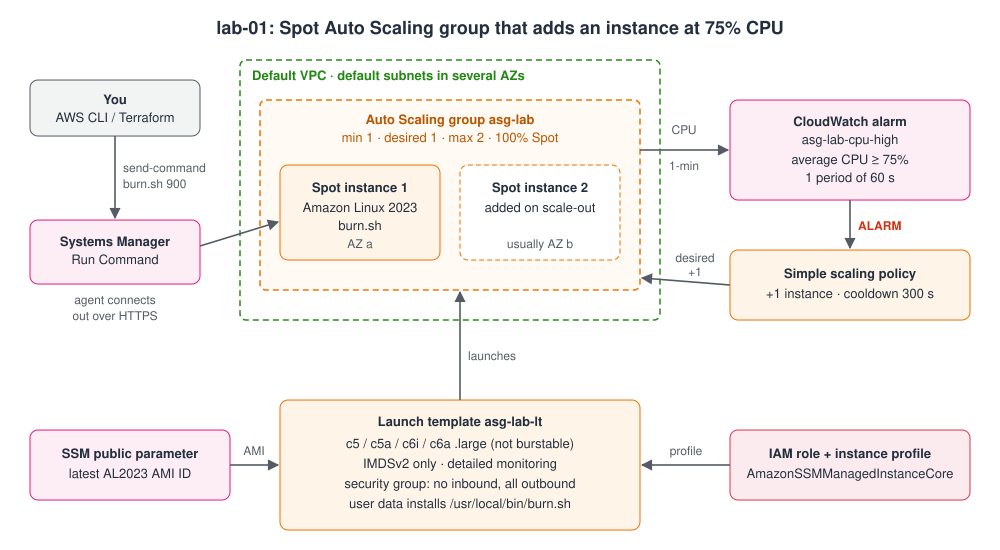
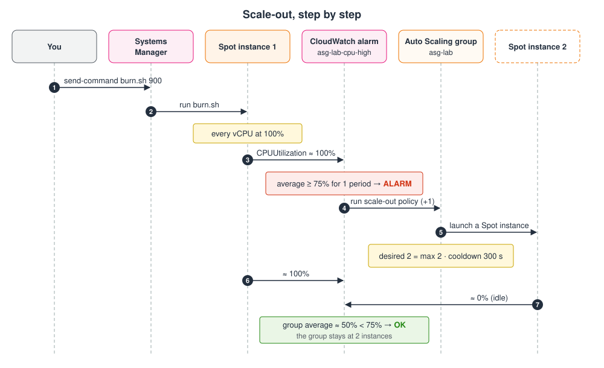
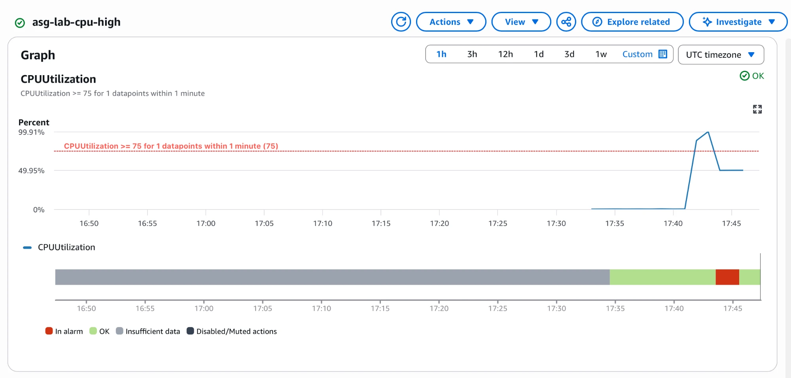
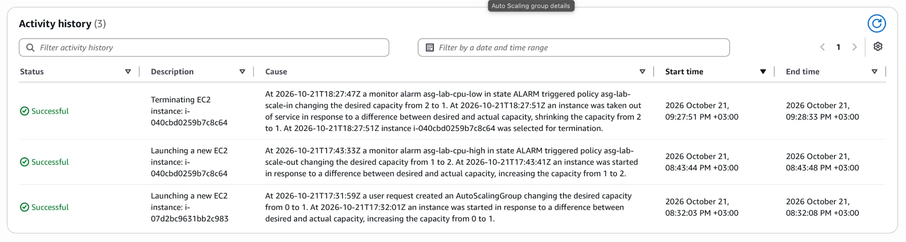

# Terraform ASG Lab: Spot Auto Scaling Group That Adds an Instance at 75% CPU

Terraform code for an Auto Scaling lab. It builds an **Auto Scaling group of Spot instances** that starts with one instance and adds a second when the group's average CPU reaches **75%**. You raise the CPU on purpose with a Systems Manager command, watch the scale-out, and destroy everything.

> **Status:** `terraform fmt` and `terraform validate` pass (Terraform 1.16.4, AWS provider 6.69.1). The plan and the run-time behavior are described from the AWS documentation. Tell me about anything that differs.

## The Solution



| Piece | What it does |
|-------|--------------|
| **Spot-only ASG** | `on_demand_base_capacity = 0` and `on_demand_percentage_above_base_capacity = 0`, with the `price-capacity-optimized` strategy. The default for the percentage is 100 (all On-Demand), so it must be set |
| **Four instance types** | `c5.large`, `c5a.large`, `c6i.large`, `c6a.large`: more Spot pools, fewer launch failures. They are **not burstable** on purpose, because a T instance (such as `t3.micro`) is throttled to a 10% baseline and the alarm would never fire |
| **Launch template** | Latest Amazon Linux 2023 (from the public SSM parameter), instance profile with `AmazonSSMManagedInstanceCore`, **no inbound security group rules**, IMDSv2 only, detailed monitoring (1-minute CPU data) |
| **Scale-out** | Simple scaling policy (+1, cooldown 300 seconds) called by the alarm `asg-lab-cpu-high` (average CPU >= 75, period 60 seconds, 1 period) |
| **Scale-in (optional)** | `enable_scale_in = true` adds a -1 policy and an alarm at 25% CPU for 5 minutes |
| **No SSH** | You run commands through **Systems Manager Run Command**. `burn.sh` (installed by user data) keeps every vCPU at 100% |

Resources created (9, plus 2 with scale-in and 1 with the Spot role): security group and its egress rule, IAM role, policy attachment and instance profile, launch template, Auto Scaling group, scaling policy, `cpu-high` alarm.

## Files

| File | Purpose |
|------|---------|
| `versions.tf` | Terraform and provider versions, the provider (Region, profile, default tags) |
| `variables.tf` | All the inputs (table below) |
| `main.tf` | The resources, the instance lookup and the CLI flags used by the outputs |
| `outputs.tf` | ASG name, instance IDs and ready-to-run commands |
| `burn.sh` | The CPU burner. Terraform embeds it in the user data |
| `user-data.sh.tftpl` | User data template: installs `burn.sh` as `/usr/local/bin/burn.sh` |

## Variables

| Variable | Default | Meaning |
|----------|---------|---------|
| `profile` | `null` | AWS CLI profile (for example an IAM Identity Center profile). Null uses the normal credential chain |
| `region` | `eu-west-1` | Region |
| `name` | `asg-lab` | Prefix of every resource name |
| `instance_types` | the four `c5`/`c6` types | Types the group may use for Spot. Keep them non-burstable |
| `min_size` / `desired_capacity` / `max_size` | `1` / `1` / `2` | Group size. `desired_capacity` is used only at creation (changes by the policy are not reverted). Use `desired_capacity=2` to start with two Spot instances |
| `cpu_high_threshold` | `75` | Average CPU percent that adds an instance |
| `enable_scale_in` | `false` | Also create the scale-in policy and alarm |
| `cpu_low_threshold` | `25` | CPU percent that removes an instance (with scale-in) |
| `capacity_rebalance` | `false` | Replace Spot instances proactively when AWS signals a risk. Recommended for production, off here to keep the lab predictable |
| `create_spot_service_linked_role` | `false` | Create `AWSServiceRoleForEC2Spot`. Set `true` **only** if the account never used Spot (creating it twice fails) |

## Commands

### 1. Sign in (pick the case that matches you)

Terraform and the `aws` commands in this README need AWS credentials. Choose **one** case, then set the shell variables below it. Check at the end of any case with `aws sts get-caller-identity` (the `Account` is the one Terraform will change).

| Case | You have | Sign in | What Terraform uses |
|------|----------|---------|---------------------|
| **A. IAM Identity Center (SSO)** | An SSO portal URL, a permission set | `aws sso login --profile <profile>` | The profile |
| **B. `aws login`** | A console sign-in (IAM user or role, no keys) | `aws login --profile <profile>` | The profile |
| **C. Access key and secret key** | An IAM user with a key pair | `aws configure --profile <profile>`, or environment variables | The profile, or the environment variables |
| **D. Temporary keys** | An access key, secret key **and session token** (copied from the SSO portal, or from `aws sts assume-role`) | Environment variables | The environment variables |
| **E. Already on AWS** | A shell on EC2, CloudShell or a build job with a role | Nothing to do | The role |

#### Case A: IAM Identity Center (SSO)

```bash
aws configure sso --profile <profile>          # once: start URL, SSO Region, account, role
aws sso login --profile <profile>              # every day, or when the session expires
# no browser on this machine: add --no-browser or --use-device-code
# one login for several profiles that share an sso-session: aws sso login --sso-session <session-name>
aws sts get-caller-identity --profile <profile>
```

#### Case B: `aws login` (console credentials)

Needs AWS CLI **2.32.0 or later** and the managed policy `SignInLocalDevelopmentAccess` on your IAM user or role.

```bash
aws --version
aws login --profile <profile>                  # opens the browser; pick your session
aws login --profile <profile> --remote         # no browser here: paste the code
aws sts get-caller-identity --profile <profile>
aws logout --profile <profile>                 # when you finish
```

The Terraform AWS provider **recognizes** an `aws login` profile (in a local test with no login done, it went looking for the login token and said it was not found), so after `aws login` use it like Case A. If your tool does not, use `aws configure export-credentials` (below).

#### Case C: access key and secret key (an IAM user's long-lived keys)

These keys **do not expire**, so treat them like a password: prefer Case A or B, give the user only the permissions the lab needs, rotate or delete the key when done, and **never put the keys in a `.tf` file, in `terraform.tfvars` or in git** (Terraform also copies secrets into state and plan files).

```bash
# Option 1: store them in a named profile (written to ~/.aws/credentials)
aws configure --profile <profile>              # asks for the access key, secret key, Region, output
aws sts get-caller-identity --profile <profile>

# Option 2: only for this shell, nothing written to disk
export AWS_ACCESS_KEY_ID=<access-key-id>
read -rs AWS_SECRET_ACCESS_KEY && export AWS_SECRET_ACCESS_KEY      # type the secret; it is not shown
aws sts get-caller-identity
```

#### Case D: temporary keys (with a session token)

```bash
export AWS_ACCESS_KEY_ID=<access-key-id>
export AWS_SECRET_ACCESS_KEY=<secret-access-key>
export AWS_SESSION_TOKEN=<session-token>
aws sts get-caller-identity
```

They **expire** (the portal shows when), and then every call fails until you paste new ones. The same variables can be produced from any logged-in profile:

```bash
eval "$(aws configure export-credentials --profile <profile> --format env)"
```

#### Case E: already running on AWS with a role

Nothing to configure: the provider finds the instance, container or CloudShell credentials by itself. Do not set a profile.

#### Set the shell variables

With a **profile** (cases A, B, C option 1):

```bash
export AWS_REGION=eu-west-1
export AWS_PROFILE=<profile>
export TF_VAR_region=$AWS_REGION            # Terraform reads TF_VAR_<name> as the variable <name>
export TF_VAR_profile=$AWS_PROFILE
export AWS_FLAGS="--region $AWS_REGION --profile $AWS_PROFILE"
```

**Without a profile** (cases C option 2, D and E): leave `AWS_PROFILE` and `TF_VAR_profile` **unset**. A profile name that does not exist stops Terraform with `failed to get shared config profile`, even when keys are in the environment.

```bash
unset AWS_PROFILE TF_VAR_profile
export AWS_REGION=eu-west-1
export TF_VAR_region=$AWS_REGION
export AWS_FLAGS="--region $AWS_REGION"
```

From here on, every command uses `$AWS_FLAGS` for the `aws` CLI, and plain `terraform ...` (the two `TF_VAR_` variables replace the `-var` flags). Precedence in short (the provider's documented order): a `profile` set in the provider block comes first, then environment variables, then the credentials file, then the config file. Check with `aws sts get-caller-identity $AWS_FLAGS` when in doubt.

Then the Spot role check:

```bash
aws sts get-caller-identity $AWS_FLAGS                                                        # the account Terraform will use
aws iam get-role $AWS_FLAGS --role-name AWSServiceRoleForEC2Spot --query Role.Arn --output text    # the Spot role must exist
```

If the Spot role is missing (`NoSuchEntity`), add `-var create_spot_service_linked_role=true` to the first apply below.

### 2. Create everything

```bash
cd lab-01
terraform init
terraform plan
terraform apply
```

Useful variations:

```bash
terraform apply -var desired_capacity=2        # start with two Spot instances
terraform apply -var enable_scale_in=true       # also shrink when CPU is low
terraform apply -var create_spot_service_linked_role=true
```

The `TF_VAR_region` and `TF_VAR_profile` variables from step 1 are read by **every** Terraform command in this folder. In a new terminal, set them again (or put `region` and `profile` in a `terraform.tfvars`, which is git-ignored).

### 3. Check that the instance is Spot

The group launches its instance a little after `apply` ends, so refresh the outputs after about a minute:

```bash
terraform apply -refresh-only
terraform output instance_ids
terraform output -raw list_instances_command | bash
```

The last column (`InstanceLifecycle`) must say **`spot`**. `None` means On-Demand: check the two `on_demand_*` settings.

### 4. Wait for Systems Manager, then raise the CPU

```bash
aws ssm describe-instance-information $AWS_FLAGS \
  --filters Key=InstanceIds,Values=$(terraform output -json instance_ids | jq -r '.[0]') \
  --query 'InstanceInformationList[0].PingStatus' --output text      # wait for: Online

terraform output -raw burn_command | bash      # keeps every vCPU at 100% for 15 minutes
```

`burn_command` already contains the first instance ID once the instance list has been refreshed. (The first command uses `jq`: install it, or copy the ID from `terraform output instance_ids`.)

### 5. Watch the scale-out

Repeat every minute or two:

```bash
terraform output -raw watch_commands | bash                          # scaling activities and the alarm
terraform apply -refresh-only
terraform output instance_ids                                       # now two IDs
terraform output -raw list_instances_command | bash
```

Or the individual commands:

```bash
aws autoscaling describe-scaling-activities $AWS_FLAGS \
  --auto-scaling-group-name asg-lab --max-items 5 \
  --query 'Activities[].[StartTime,StatusCode,Description,Cause]' --output table

aws cloudwatch describe-alarms $AWS_FLAGS \
  --alarm-names asg-lab-cpu-high --query 'MetricAlarms[0].[StateValue,StateReason]' --output text

aws autoscaling describe-auto-scaling-groups $AWS_FLAGS \
  --auto-scaling-group-names asg-lab \
  --query 'AutoScalingGroups[0].[DesiredCapacity,Instances[].[InstanceId,AvailabilityZone,LifecycleState]]'
```

**Expected**: within 1 to 3 minutes of the burner starting, the alarm is `ALARM`, a scaling activity "Launching a new EC2 instance" appears with the alarm as its cause, and `DesiredCapacity` becomes **2** with a second Spot instance (usually in another Availability Zone). It stops at 2 because `max_size` is 2.

What happens, step by step:



In the CloudWatch console the alarm `asg-lab-cpu-high` looks like this:



The CPU climbs to about 100% once the burner starts and crosses the 75% line, so the alarm goes **In alarm** (red) and the group launches the second instance. When that instance joins, the group average drops to about **50%**: one instance at 100%, the new one idle. That is below 75%, so the alarm goes back to **OK**.

> **Note:** an alarm going back to OK does not remove an instance. By default (`enable_scale_in = false`) the group **stays at 2** until you run `terraform destroy`, and a later `apply` does not reset `desired_capacity`. With `-var enable_scale_in=true`, the `cpu-low` alarm removes one instance when the average stays at or below 25% for 5 minutes. That only happens after the burner stops: while it runs the average is about 50%. With `burn.sh 900`, expect the group back at 1 instance about 20 minutes after you start it. Either instance may be terminated, not necessarily the newer one.

A full run with scale-in enabled, in the group's **Activity history** (newest first):



Read it from the bottom up: the group is created and launches its first instance (desired 0 → 1), `asg-lab-cpu-high` runs `asg-lab-scale-out` (1 → 2), and later `asg-lab-cpu-low` runs `asg-lab-scale-in` (2 → 1). In this run the instance that scale-in terminated happened to be the one scale-out had added.

### 6. See a Spot replacement (optional)

```bash
aws ec2 terminate-instances $AWS_FLAGS --instance-ids <instance-id>
```

The group notices and launches a new Spot instance to get back to the desired capacity.

### 7. Destroy everything

> **Warning: `terraform destroy` terminates the instances and deletes everything in the lab. This cannot be undone.**

```bash
terraform destroy

aws autoscaling describe-auto-scaling-groups $AWS_FLAGS \
  --auto-scaling-group-names asg-lab --query 'AutoScalingGroups[].AutoScalingGroupName'     # expect: []
aws cloudwatch describe-alarms $AWS_FLAGS \
  --alarm-name-prefix asg-lab --query 'MetricAlarms[].AlarmName'                             # expect: []
```

If you created the Spot service-linked role with `create_spot_service_linked_role=true`, destroy deletes it too. Do not do that if other things in the account use Spot.

## Troubleshooting

| Symptom | Cause and fix |
|---------|---------------|
| `Error: No valid credential sources found` | No profile was found. Check the **last line** of the error: `no EC2 IMDS role found` means nothing named a profile (set `AWS_PROFILE` and `TF_VAR_profile`, see step 1); `failed to read cached SSO token file` means you are not logged in (`aws sso login --profile <your-profile>`); `failed to get shared config profile, <name>` means the profile name is wrong |
| CPU stays near **10%** and the alarm never fires | The instances are **T types**, throttled to their baseline. Use the default `c5`/`c6` types |
| Apply fails creating the ASG with a Spot error | The Spot service-linked role is missing. Set `create_spot_service_linked_role=true` once |
| "Service-linked role already exists" | You set that variable when the role is there. Set it back to `false` |
| The group has no instance and the activity says capacity is not available | Spot pools are empty. Add instance types: `-var 'instance_types=["c5.large","c5a.large","c6i.large","c6a.large","m5.large"]'` |
| `instance_ids` is empty | The group has not launched yet, or you did not refresh: `terraform apply -refresh-only` |
| The instance never shows `Online` in Systems Manager | No route to the internet (private subnet without NAT), the role lacks the policy, or the agent has not started |
| `burn.sh` not found on the instance | The instance was launched before the template had it. Terminate it so the group replaces it from the latest template version |
| Instances show `None` instead of `spot` | `on_demand_percentage_above_base_capacity` or `on_demand_base_capacity` is not 0 |

## Costs and Safety

- Up to two Spot `c5`-class instances for under an hour, **detailed monitoring** (a small per-instance charge) and the alarms. Prices vary by Region and time, so check the Spot pricing page.
- **Destroy the lab when you finish.** The ASG keeps instances running, and alarms and detailed monitoring keep billing, until you do.
- Do not commit `terraform.tfstate` or `terraform.tfvars` (the repository's root `.gitignore` already excludes them).
- Use a **sandbox account**. To make the code refuse to run in another account, add `allowed_account_ids = ["<account-id>"]` to the provider block.